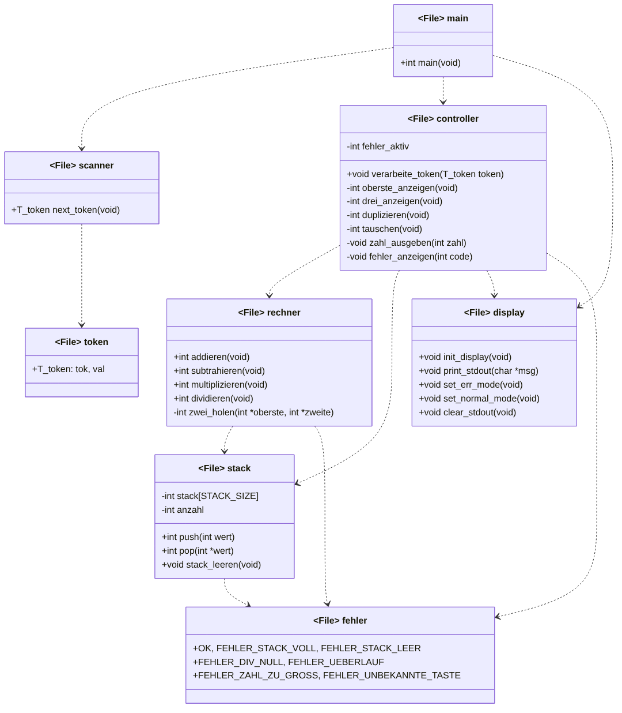

# Modulkonzept – GSPA1 RPN-Taschenrechner

Notation wie in der Vorlesung (FS 2, F37–41): `+` = öffentlich (steht in der .h),
`-` = privat (`static` in der .c), gestrichelter Pfeil = „benutzt“.
Nicht eingezeichnet: scanner benutzt zusätzlich display (Echo der Ziffern) und keypad (ITS_BRD_LIB).

## Module und Begründung

| Modul | Zweck (ein Satz) | Warum eigenes Modul |
|---|---|---|
| main | Initialisiert das Board und gibt jedes Token an den Controller. | Nur Ablauf, keine Logik. |
| controller | Entscheidet pro Token, welche Aktion ausgeführt wird, und meldet Fehler. | Trennt Bedienung von Rechenlogik; hält den Fehlerzustand. |
| rechner | Rechnet + - * / mit den zwei obersten Stack-Werten und prüft Bereichsüberschreitung. | Reine Rechenlogik, ohne Hardware testbar. |
| stack | Speichert die Zahlen (Array fester Größe + Füllstand). | Kapselt die Daten: Array und Zähler sind privat, Zugriff nur über push/pop. |
| fehler | Legt die einheitlichen Fehlercodes fest. | Alle Module nutzen dieselben Codes. |
| scanner, display, token | Eingabe, Ausgabe, Token-Typ. | Vorgegeben (Aufgabenblatt). |

## Schnittstellen-Regeln

- Funktionen, die scheitern können, liefern per `return` einen Status (siehe Fehlerkonzept).
- Ergebnisse kommen über einen Zeiger-Parameter (`pop(int *wert)`) oder direkt auf den Stack.
- Bei `-` und `/` gilt: zweiter Wert von oben OP oberster Wert.
